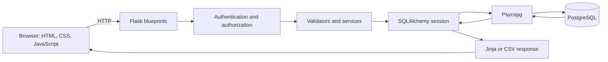
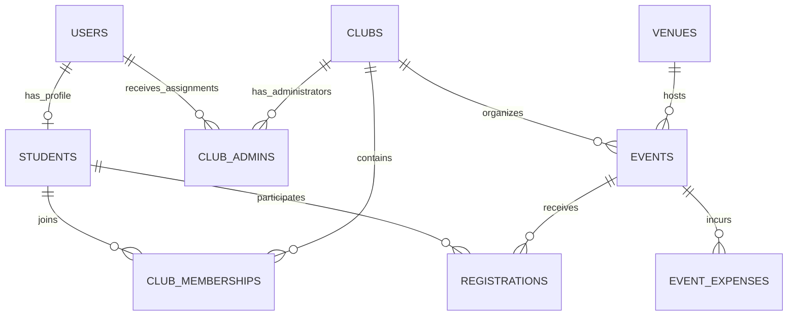

# 1. Project Overview

The **University Event and Club Management System** is a server-rendered web application for coordinating university clubs, memberships, campus events, venue bookings, participation, and event expenditure. Its interface uses the name **CampusConnect**. It is also a practical DBMS study: its pages depend on related tables, constraints, transactions, joins, and aggregate queries.

University activities involve facts that must agree. A student must not receive duplicate registrations for an event. Events must not reserve the same venue at overlapping times. A successful registration must correspond to an available seat. Organizers must access private information only for clubs they administer. The implementation combines request validation, authorization, transactional services, and PostgreSQL constraints to address these problems.

| Stored role | Main responsibilities |
| --- | --- |
| `student` | Edit permitted profile fields, join/leave clubs, register/cancel event participation, and view personal history. |
| `club_admin` | Edit assigned clubs, manage members, schedule events, record attendance, manage expenses, and inspect scoped reports. |
| `system_admin` | Manage clubs/venues, inspect private student records, and manage events and reports across clubs. |

Visitors can browse public club, venue, and event directories. Profiles, rosters, participant lists, and financial reports require authorization. Public registration creates students only.

The overall principle is: the browser sends an HTTP request; Flask selects a route; the route checks the caller and validates input; SQLAlchemy reads or updates PostgreSQL; Flask returns rendered HTML, a redirect, or CSV. JavaScript improves navigation and confirmations, while server code controls permissions and data integrity.

Implemented features include profile editing, club activation/deactivation, membership reactivation, venue editing, event scheduling and status changes, registration, attendance, expense CRUD, financial summaries, participation analytics, and CSV exports. There are no payment, revenue, budget, expense-category, notification, or complete status-audit tables. There is no general user-management or administrator-assignment web interface; `ClubAdmin` records represent assignments used by authorization.

# 2. Technology Stack

## 2.1 Backend and libraries

These version ranges come from `requirements.txt`; they are accepted versions, not a statement of exact installed versions.

| Technology | Dependency | Actual purpose |
| --- | --- | --- |
| Python | Runtime, not pinned | Routes, validation, transactions, reports, CLI commands, and tests. Standard-library modules include `datetime`, `decimal`, `zoneinfo`, `secrets`, `csv`, and `dataclasses`. |
| Flask | `Flask>=3.1,<3.2` | Factory, routing, blueprints, requests/responses, sessions, templates, and CLI integration. |
| Flask-SQLAlchemy | `Flask-SQLAlchemy>=3.1,<3.2` | Attaches ORM models, engines, and scoped sessions to Flask. |
| SQLAlchemy | Transitive dependency | Maps classes to tables and builds parameterized SQL, joins, aggregates, and locking reads. |
| PostgreSQL | External server | Persistent relational data, keys/checks, transactions, row locks, and booking exclusion. |
| Psycopg | `psycopg[binary]>=3.2,<4` | PostgreSQL driver behind the `postgresql+psycopg` URL scheme. |
| Flask-Migrate | `Flask-Migrate>=4.1,<5` | Integrates migration commands with Flask. |
| Alembic | Transitive dependency | Tracks ordered schema revisions and executes migration operations. |
| Flask-Login | `Flask-Login>=0.6.3,<0.7` | Current identity, login/logout helpers, and authenticated route protection. |
| Werkzeug | `Werkzeug>=3.1,<3.2` | Password hashing/verification; `User.set_password()` explicitly selects scrypt. |
| python-dotenv | `python-dotenv>=1.0,<2` | Loads local environment settings without replacing existing process values. |
| pytest | `pytest>=8,<10` | Fixtures, parametrization, assertions, and test selection. |

Jinja, supplied with Flask, combines templates with route data and escapes ordinary HTML output. Click supplies the command-line framework used through Flask. They are not separately listed in the requirements file.

## 2.2 Browser technologies and communication

HTML provides forms, links, tables, and labels. Jinja inserts data before sending HTML to the browser. Bootstrap **5.3.3 CSS** comes from jsDelivr and supplies responsive grids and utilities. Local CSS adds campus colors, focus indicators, cards, forms, and mobile rules.

The deferred local JavaScript controls navigation, optional confirmation prompts, and keyboard-focusable table regions. The application does not load Bootstrap's JavaScript bundle or use a frontend framework. Forms submit directly to Flask; there is no browser API client allocating seats. Bootstrap styling needs CDN availability, but security and database operations do not run through that CDN.



The ORM is an abstraction above SQL. `session.add()` makes an object pending; `flush()` sends SQL within the current transaction; `commit()` completes it. PostgreSQL can reject a write even when Python validation has succeeded.

# 3. Complete Project Directory Structure

This tree lists relevant tracked files. Credentials, virtual environments, Git internals, instance files, and generated caches are excluded. There is no tracked `.env.example` in this checkout.

```text
dbms_project/
|-- .gitignore
|-- .vscode/
|   `-- settings.json
|-- README.md
|-- requirements.txt
|-- pytest.ini
|-- app/
|   |-- __init__.py
|   |-- config.py
|   |-- extensions.py
|   |-- models.py
|   |-- security.py
|   |-- errors.py
|   |-- dashboards.py
|   |-- seed.py
|   |-- main/
|   |   `-- __init__.py
|   |-- auth/
|   |   |-- __init__.py
|   |   |-- authorization.py
|   |   |-- cli.py
|   |   `-- validation.py
|   |-- management/
|   |   |-- __init__.py
|   |   |-- services.py
|   |   `-- validation.py
|   |-- events/
|   |   |-- __init__.py
|   |   |-- services.py
|   |   `-- validation.py
|   |-- reports/
|   |   |-- __init__.py
|   |   |-- csv_export.py
|   |   |-- queries.py
|   |   `-- validation.py
|   |-- static/
|   |   |-- css/style.css
|   |   `-- js/app.js
|   `-- templates/
|       |-- base.html
|       |-- main/index.html
|       |-- auth/
|       |   |-- login.html
|       |   `-- register.html
|       |-- dashboards/
|       |   |-- layout.html
|       |   |-- student.html
|       |   |-- club_admin.html
|       |   |-- system_admin.html
|       |   `-- club_scope.html
|       |-- errors/
|       |   |-- 400.html
|       |   |-- 403.html
|       |   `-- status.html
|       |-- management/
|       |   |-- profile.html
|       |   |-- students.html
|       |   |-- clubs.html
|       |   |-- club_detail.html
|       |   |-- edit.html
|       |   |-- members.html
|       |   |-- memberships.html
|       |   |-- venues.html
|       |   `-- macros.html
|       |-- events/
|       |   |-- directory.html
|       |   |-- detail.html
|       |   |-- form.html
|       |   |-- history.html
|       |   `-- participants.html
|       `-- reports/
|           |-- expenses.html
|           |-- expense_form.html
|           |-- expense_delete.html
|           |-- financial.html
|           |-- analytics.html
|           |-- dashboard_summary.html
|           `-- macros.html
|-- migrations/
|   |-- README
|   |-- alembic.ini
|   |-- env.py
|   |-- script.py.mako
|   `-- versions/
|       |-- 0001_initial_initial_normalized_university_schema.py
|       `-- 0002_club_active.py
|-- scripts/
|   |-- generate_initial_migration.py
|   |-- generate_schema_docs.py
|   |-- verify_database.py
|   `-- verify_templates.py
|-- tests/
|   |-- __init__.py
|   |-- conftest.py
|   |-- helpers.py
|   |-- test_foundation.py
|   |-- test_models.py
|   |-- test_migration.py
|   |-- test_auth.py
|   |-- test_management.py
|   |-- test_events.py
|   |-- test_event_concurrency.py
|   |-- test_reports.py
|   `-- test_final_qa.py
`-- docs/
    |-- authentication.md
    |-- database-design.md
    |-- er-diagram.md
    |-- er-diagram.mmd
    |-- schema.md
    |-- phase4-management.md
    |-- phase5-events.md
    |-- phase6-reports.md
    |-- final-demo-guide.md
    |-- final-testing-report.md
    `-- viva-preparation.md
```

# 4. Detailed File-by-File Code Explanation

## 4.1 Application construction and shared infrastructure

### `app/__init__.py`

`create_app(test_config=None)` constructs and returns the Flask application. A factory creates an app when called instead of requiring a global app during every import. Tests can create independently configured instances with shared model definitions.

It loads environment settings with `load_dotenv(..., override=False)`, creates `Flask(__name__, instance_relative_config=True)`, loads `environment_config()`, and applies the optional test mapping. Missing secret/database configuration is rejected. Outside `TESTING`, the driver must be `postgresql+psycopg`.

It initializes `db`, imports models to register metadata, initializes `migrate`/`login_manager`, and registers six blueprints: main, auth, dashboards, management, events, and reports. It attaches CLI commands, the CSRF request hook, security response hook, token template helper, and error handlers.

The nested `check_db()` command connects and executes `SELECT 1`, reporting generic SQLAlchemy failures without driver details. It checks connectivity when executed, not complete schema validity. Startup never automatically migrates or seeds tables.

### `app/config.py`

`environment_config()` returns a dictionary from environment variables. APP_ENV accepts development/production/testing, defaulting to development. DATABASE_URL maps to SQLALCHEMY_DATABASE_URI; SECRET_KEY signs session data. Neither value is embedded in code.

Configuration disables ORM modification tracking, enables connection `pool_pre_ping`, and sets HttpOnly/Lax session cookies, with Secure in production. Remember-cookie flags are configured too. Permanent sessions last eight hours with refresh-on-each-request disabled. Requests are limited to 64 KiB and CSRF tokens to one hour.

No tables are queried here. The factory's missing-configuration messages mention `.env.example`, but that file is absent from the current tracked tree; the actual variable names are described above.

### `app/extensions.py`

Defines unbound `db`, `migrate`, and `login_manager` objects, attached later through `init_app()`. Modules can import extensions without constructing the app, reducing circular imports.

SQLAlchemy metadata uses predictable names for primary/foreign keys, indexes, uniqueness, and checks. Flask-Login uses `auth.login` as its login view and strong session protection.

`load_user(user_id)` accepts only a short ASCII decimal string in the positive PostgreSQL integer range and calls `db.session.get(User, identifier)`. Invalid/nonexistent IDs return None. Reading users on later requests means permissions use the current database role rather than a browser-supplied role.

### `app/security.py`

`csrf_token()` generates 64 hexadecimal characters using `secrets.token_hex(32)`, storing the token/time in the session and reusing it until expiry. Templates call its registered global.

`protect_csrf()` runs before POST/PUT/PATCH/DELETE, checking presence, ASCII shape, length, age, and constant-time `compare_digest()` equality. Invalid writes stop with 400 before business operations. This is custom synchronizer-token protection; Flask-WTF is not used.

`security_headers(response)` adds nosniff, frame protection, same-origin referrer policy, and CSP allowing the stylesheet CDN and same-origin forms. Production receives HSTS; non-static responses get no-store. These helpers operate on HTTP/session state, not domain tables.

### `app/errors.py`

`TITLES` maps public error codes. `error_response(code, message)` directly renders errors/status.html through Jinja with explicit values and url_for. It bypasses context processors that might reload current_user during database failure, retaining HTML escaping.

`rollback_safely()` rolls back and suppresses a further SQLAlchemy error if the broken connection also prevents rollback. `register_errors(app)` installs bad_request, forbidden, missing, conflict, internal_error, unavailable, and database_error handlers. They distinguish 400/403/404/409/500/503. Unexpected and database failures do not reflect exception details. The fallback performs no new domain query.

### `app/main/__init__.py`

`index()` serves GET / using main/index.html. `health()` serves GET /health with `{"status": "ok", "database": "not_checked"}`. Health deliberately does not query PostgreSQL: it proves liveness, not connectivity. The separate check-db CLI command checks a connection.

### `app/models.py`

Declares nine db.Model classes: User, Student, Club, ClubMembership, ClubAdmin, Venue, Event, Registration, and EventExpense. Their columns/keys/checks/indexes form ORM metadata; Section 6 details every table.

User also inherits UserMixin. `get_id()` returns a string ID, `set_password(password)` stores a scrypt hash, and `check_password(password)` verifies it while safely rejecting invalid hash formats.

Relationships use back_populates, such as registration.event and event.registrations. User.student is scalar with uselist=False and a unique student foreign key. Model constraints do not replace current-state service checks for seats, venue capacity, or transitions. PostgreSQL's ExcludeConstraint independently guards venue intervals.

### `app/dashboards.py`

| Function | Route | Responsibility |
| --- | --- | --- |
| `index()` | GET /dashboard | Requires login; redirects by role or denies unknown role. |
| `student()` | GET /dashboard/student | Requires profile; selects up to five future scheduled events with own registered rows; calls personal_summary. |
| `club_admin()` | GET /dashboard/club-admin | Joins Club/ClubAdmin for assigned clubs and scoped summaries. |
| `system_admin()` | GET /dashboard/system-admin | System-wide summaries for the exact system role. |
| `club_scope(club_id)` | GET `/clubs/<club_id>/dashboard` | Checks club authority and renders management links. |

`report_summary()` imports Filters/analytics_report/finance_report when needed and calls both with current_user. Students do not request financial summaries. Queries use users/students/clubs/assignments/events/registrations, with report functions additionally reading expenses.

### `app/seed.py`

`seed_data(session)` adds missing development examples without committing. Nested `get_or_add(model, lookup, **values)` finds by stable lookup and inserts only absent rows. Examples cover clubs, venues, profiles, organizer assignment, events, memberships, registrations, and expenses.

Existing cancelled rows/event dates remain unchanged. New account hashes use random secrets, supplying no usable default passwords. Student-number/account mismatches raise an error. `seed_dev(confirm)` requires development mode/explicit opt-in, wraps everything in one transaction, and reports generic failure. It can write all nine tables but is never invoked by startup.

## 4.2 Authentication package

### `app/auth/__init__.py`

The auth blueprint uses /auth. It imports database/error helpers, User/Student, validation, and Flask-Login.

`safe_next(target)` accepts only unambiguous root-relative local paths, rejecting scheme/host, protocol-relative paths, backslash, percent characters, and control/whitespace ambiguities. Local destinations retain their usual authorization.

`register()` handles GET/POST /auth/register. POST validates a whitelist, fixes role to student, hashes password, creates User/Student, and commits once. Integrity conflicts roll back both and return generic 400; database failures return 503. Success clears old session state and redirects to login without authenticating.

`login()` handles GET/POST /auth/login. It normalizes email, bounds password processing, queries users, and verifies a real/dummy scrypt hash. Unknown email and wrong password share generic 401 feedback. Success clears old session, calls login_user with remember=False/fresh=True, makes the session permanent, clears legacy remember state, and redirects safely or to /dashboard.

`logout()` is POST-only /auth/logout with login_required, logout_user, session clearing, and remember-state clearing. GET cannot log out; CSRF applies.

### `app/auth/validation.py`

| Function | Purpose |
| --- | --- |
| `valid_text(value, maximum)` | Nonblank printable bounded text. |
| `normalize_email(value)` | Trimmed lowercase email. |
| `valid_email(value)` | ASCII syntax, length/domain-label/dot-pattern checks; not mailbox verification. |
| `valid_password(value)` | Printable 12–128 character passphrase, not all whitespace. |
| `registration_input(form)` | Sanitized non-secret display values plus errors, including password/confirmation checking. |

Student numbers follow `[A-Za-z0-9][A-Za-z0-9/_-]{2,39}`. Returned values omit passwords/privileged fields. Database uniqueness remains essential because valid submissions can race.

### `app/auth/authorization.py`

`roles_required(*roles)` wraps login_required and exact-role checks: anonymous redirects, unsuitable signed-in roles get 403. `can_manage_club(user, club_id)` allows system administrators or club administrators with a matching ClubAdmin row, not another club's assignment.

`club_admin_required(view)` applies this to routes receiving club_id, retaining the system override. Wrappers preserve metadata with functools.wraps. Dashboards/management/events/reports reuse them; hiding a button is not authorization.

### `app/auth/cli.py`

`create_admin()` prompts for name/email and hidden confirmed password, validates shared rules, and creates a hashed system_admin User. Within db.session.begin(), PostgreSQL takes a fixed-key transaction advisory lock, serializing initial-admin attempts.

It refuses an existing system administrator or used email, supplies no default credentials, and reports generic failures. It is a bootstrap command, not general account promotion/editing.

## 4.3 Student, club, membership, and venue management

### `app/management/__init__.py`

This blueprint imports models, authorization, membership services, validators, and safe errors. Shared helpers are:

| Helper | Responsibility |
| --- | --- |
| `save_changes()` | Commit; rollback with safe duplicate feedback or database 503. |
| `get_record(model, identifier, lock=False)` | PK query, optional FOR UPDATE, missing row 404. |
| `my_student()` | Current profile or rejection. |
| `query_text(name='q', maximum=150)` | Bounded printable query input. |
| `page(statement)` | ASCII page validation and ten-row database pagination. |
| `page_url(number)` | Paging links preserving recognized filters/path arguments. |

| Function | Route | Behavior |
| --- | --- | --- |
| `profile()` | GET /profile | Own student profile. |
| `profile_edit()` | GET/POST /profile/edit | Updates only User.full_name and Student.department/batch. |
| `students()` | GET /students | System-only name/email/number search and exact department. |
| `student_detail(student_id)` | GET `/students/<student_id>` | Owner student or system only. |
| `clubs()` | GET /clubs | Public search; active(default)/inactive/all; pagination. |
| `club_detail(club_id)` | GET `/clubs/<club_id>` | Public description, own membership, permitted controls. |
| `club_create()` | GET/POST /clubs/new | System-only club_form. |
| `club_edit(club_id)` | GET/POST `/clubs/<club_id>/edit` | Assigned manager/system; locks on POST. |
| `club_status(club_id)` | POST `/clubs/<club_id>/status` | System-only locked activation change. |
| `join_club(club_id)` | POST `/clubs/<club_id>/join` | Current student's activation. |
| `leave_club(club_id)` | POST `/clubs/<club_id>/leave` | Current student's cancellation. |
| `memberships()` | GET /memberships | Own history with club search/status. |
| `club_members(club_id)` | GET `/clubs/<club_id>/members` | Scoped private roster. |
| `member_status(club_id, membership_id)` | POST `/clubs/<club_id>/members/<membership_id>/status` | Scoped active/cancelled transition. |
| `venues()` | GET /venues | Public name/location search. |
| `venue_create()` | GET/POST /venues/new | System-only venue_form. |
| `venue_edit(venue_id)` | GET/POST `/venues/<venue_id>/edit` | System-only, locks on POST. |

Student search joins Student/User and eager-loads relationships. icontains(autoescape=True) treats wildcard input literally. Profile editing ignores submitted email/role/number/owner IDs.

`club_form(club=None)` validates name/description and commits creation/edit; extra activation fields are ignored. Deactivation preserves relationships. `change_my_membership(club_id, target)` locks Club, calls student_membership, commits, and redirects. Roster queries join membership/student/user; member_status selects by both IDs to reject cross-club substitution.

`venue_form(venue=None)` validates and prevents reducing capacity below any non-cancelled existing event's capacity, including completed events. In-place updates preserve foreign-key relationships. These operations span users/students/clubs/memberships/assignments/venues/events as appropriate.

### `app/management/services.py`

`transition_membership(membership, club, target)` permits active/cancelled, requiring an active club for activation, and updates without committing. `student_membership(club, student, target)` uses the shared db.session to lock an existing pair, inserts on first join, reuses cancellation, and does not insert on absent leave. Original joined_at remains.

The route's Club lock serializes operations even before a membership row exists; pair uniqueness adds database protection. Services modify club_memberships and inspect club state; callers complete transactions.

### `app/management/validation.py`

PROFILE_FIELDS, CLUB_FIELDS, and VENUE_FIELDS provide labels/limits for routes/shared forms. `text_fields(form, fields)` trims allowed fields and returns values/errors; descriptions allow normal multiline whitespace. `venue_input(form)` requires ASCII capacity digits within 1–2,147,483,647, rejecting decimals, zero, negatives, excessive input, and lookalike digits. No database calls occur.

## 4.4 Events and registrations

### `app/events/__init__.py`

Adapts HTTP to event services, importing shared query/pagination helpers, authorization, models, validation, and services. `rule_failure(error)` rolls back and renders RuleViolation's status/message. `database_failure(error)` maps exclusion 23P01 to venue conflict, other integrity to 409, lock/deadlock/serialization states to retry-oriented 409, and remaining failures to safe 503.

`campus_time(value, pattern=...)` is the local-time Jinja filter. `identifier_filter(name)` validates numeric query IDs. `filtered_events(statement)` adds text/status/time/club/venue/date filters. `directory(statement, heading, manage)` eager-loads club/venue, paginates, and gets occupied counts for displayed IDs in one grouped query.

| Function | Route | Purpose |
| --- | --- | --- |
| `index()` | GET /events | Public discovery. |
| `manage()` | GET /events/manage | Assigned manager scope or system-wide. |
| `club_events(club_id)` | GET `/clubs/<club_id>/events` | Authorized club list. |
| `detail(event_id)` | GET `/events/<event_id>` | Public data, seats, own registration, permitted controls. |
| `create(club_id)` | GET/POST `/clubs/<club_id>/events/new` | Scoped creation through event_form. |
| `edit(event_id)` | GET/POST `/events/<event_id>/edit` | Role and owning-club permission. |
| `status(event_id)` | POST `/events/<event_id>/status` | change_event_status then commit. |
| `register(event_id)` | POST `/events/<event_id>/register` | register_student with trusted profile then commit. |
| `cancel(event_id)` | POST `/events/<event_id>/registration/cancel` | cancel_registration then commit. |
| `history()` | GET /registrations | Own history with related event/club/venue. |
| `participants(event_id)` | GET `/events/<event_id>/participants` | Scoped roster joining students/users. |
| `participant_status(event_id, registration_id)` | POST `/events/<event_id>/participants/<registration_id>/status` | mark_participant then commit. |

`event_form(club, event=None)` prepares local display times, validates with event_input, calls save_event, then commits. It ignores extra owner/status fields; invalid inputs re-render 400. Detail-page flags improve controls, but services recheck at POST because data may change. Queries cover clubs/assignments/venues/events/registrations/students/users as needed.

### `app/events/validation.py`

CAMPUS_TIMEZONE is ZoneInfo('Asia/Dhaka'); EVENT_FIELDS supplies limits. `event_input(form)` returns typed values, display strings, and errors. It validates text, positive bounded IDs/capacity, ISO datetime input, and end after start. Naive datetime-local is interpreted in campus time then converted to UTC. Actual venue existence/activity/capacity/conflicts belong to services.

### `app/events/services.py`

Services receive a session and flush but never commit, leaving all-or-nothing completion to the caller.

| Name | Responsibility |
| --- | --- |
| `OCCUPIED` | Registered and attended occupy seats. |
| `RuleViolation` | Public business message/status, usually 409. |
| `now_utc()` | Replaceable aware UTC clock. |
| `utc(value)` | Normalize aware timestamps; treat SQLite naive values as UTC. |
| `locked(session, model, identifier, shared=False)` | Locking load with identity refresh; 404 if missing. |
| `require_manager(session, actor, club_id)` | System or matching club assignment. |
| `seats_used(session, event_id)` | Count occupied registrations. |
| `event_and_club(session, event_id)` | Shared Club then exclusive refreshed Event. |
| `register_student(session, event_id, student_id, now=None)` | Recheck eligibility/capacity; reuse occupied/cancelled pair or insert. |
| `cancel_registration(session, event_id, student_id, now=None)` | Same locks; eligible cancellation; absent/already-cancelled no-op. |
| `save_event(session, actor, values, event_id=None, club_id=None, now=None)` | Authorize, lock active club/sorted venues/existing event; validate dates/capacity/overlap; flush allowed fields. |
| `change_event_status(session, actor, event_id, target, now=None)` | Scheduled to cancelled/completed, completion after end. |
| `mark_participant(session, actor, event_id, registration_id, target, now=None)` | Scoped registered/attended toggle after start, never enrollment/reactivation. |

These functions read/write clubs, assignments, venues, events, and registrations. Sections 8–9 explain state and lock rules.

## 4.5 Expense and reporting package

### `app/reports/__init__.py`

Imports shared authorization/query helpers, models, aggregate queries, expense validation, CSV serialization, and safe error handling. `database_error(error)` rolls back with generic 503; `money(value)` formats two decimal places/separators without performing accounting arithmetic or adding currency metadata.

`manager_event(event_id)` fetches and authorizes its club. `report_filters()` validates canonical dates, ordering, IDs, actor scope, and club/event consistency, returning Filters. `choices()` returns authorized clubs/events only. `paginate_rows(rows)` paginates materialized report rows in groups of ten, rather than adding SQL LIMIT to aggregates.

| Function | Route | Behavior |
| --- | --- | --- |
| `expenses(event_id)` | GET `/events/<event_id>/expenses` | Private description/date search, matching total, database pagination. |
| `expense_create(event_id)` | GET/POST `/events/<event_id>/expenses/new` | Authorized event and expense_form. |
| `expense_edit(event_id, expense_id)` | GET/POST `/events/<event_id>/expenses/<expense_id>/edit` | Exact pair, locked on POST. |
| `expense_delete(event_id, expense_id)` | GET/POST `/events/<event_id>/expenses/<expense_id>/delete` | GET confirms; POST requires confirm=delete and commits deletion. |
| `financial()` | GET /reports/financial | Financial aggregates and event-row pagination. |
| `analytics()` | GET /reports/analytics | Participation aggregates and event-row pagination. |
| `financial_csv()` | GET /reports/financial.csv | Same filtered financial event rows as HTML. |
| `participation_csv()` | GET /reports/participation.csv | Same filtered participation rows as HTML. |

`scoped_expense(event_id, expense_id, lock=False)` selects by both IDs. `expense_form(event, expense=None)` validates/creates/updates description, amount, and date, commits, and redirects. Ownership comes from the authorized URL; extra event_id cannot transfer it. Invalid input returns 400.

CRUD writes EventExpense, checking Event/ClubAdmin scope; reports additionally read Club/Registration. GET downloads require authorization but do not change domain records and need no form CSRF token.

### `app/reports/validation.py`

`expense_input(form)` returns typed values, display strings, and errors. Description is bounded/nonblank. Amount grammar accepts ASCII digits with up to two fractional digits; direct string-to-Decimal conversion is quantized to 0.01.

Zero is valid; negatives, scientific notation, commas, non-finite values, extra precision, and values above 9999999999.99 are invalid. This matches Numeric(12,2): twelve total digits, two fractional. Dates must round-trip as canonical YYYY-MM-DD. There are no database side effects.

### `app/reports/queries.py`

`Filters` is a frozen dataclass of optional from_date, to_date, club_id, and event_id. It is a structured value, not a database table. `club_scope(actor)` selects all clubs for system administrators, assigned clubs for club administrators, and none for other roles. `event_scope(actor, filters)` builds on that with chosen IDs. SQL excludes unauthorized rows before returning aggregates.

`expense_conditions(filters)` supplies inclusive expense-date predicates. `dated_events(statement, filters)` creates UTC event-start boundaries from campus days. `percentage(numerator, denominator)` returns one-decimal Decimal with half-up rounding or None for zero denominator.

`finance_report(session, actor, filters)` groups expenses by event, outer-joins totals to scoped events/clubs, and returns event rows, club rows, monthly expenditure, total, and five highest-spending events. COALESCE gives missing amounts decimal zero. Raw registrations are never joined into expense sums.

`analytics_report(session, actor, filters)` groups registrations with conditional status sums, joins dated events, and calculates occupancy/completed attendance. It returns event rows, overall summary, club participation, monthly starts, and five popular events. Monthly PostgreSQL grouping uses timezone('Asia/Dhaka', ...); SQLite tests use a datetime-offset expression.

`personal_summary(session, student_id)` joins only the student's registrations/events and returns total, registered, attended, cancelled, upcoming, and non-cancelled past participation. It never reads expenses. Section 10 explains metric/date definitions.

### `app/reports/csv_export.py`

`safe_cell(value)` converts nulls, decimals, numbers, and strings to cell content. It detects spreadsheet formula prefixes, including relevant whitespace/BOM/full-width variants, and prepends an apostrophe. CSV quoting alone would not stop spreadsheet evaluation of a title beginning with '='.

`csv_response(filename, headers, rows)` uses csv.writer, all fields quoted, CRLF, UTF-8, fixed attachment filenames, and no-store. Decimal output is fixed-point. No queries occur here; authorized routes supply rows.

## 4.6 Shared, authentication, dashboard, and error templates

Templates receive route data rather than explicit SQL. ORM relationship access can trigger lazy loading, so list routes often eager-load relationships. State-changing forms below include CSRF; GET forms only filter records.

### `app/templates/base.html`

Defines viewport metadata, Bootstrap/local CSS, deferred local JavaScript, overridable title/content blocks, skip link, flashed live feedback, and footer. Public links expose directories. Students get own profile/membership/history; system administrators get private students; managers get event/reports. Signed-in users get dashboard and POST logout, visitors login/registration. Routes independently enforce permissions.

### `app/templates/main/index.html`

Public introduction/feature cards rendered by main.index, extending base with an exploration anchor. No database list or write form is present.

### `app/templates/auth/login.html`

POSTs email/password/token/next to auth.login. Password uses current-password autocomplete and is never repopulated. Generic errors and registration link support recovery. The hidden redirect still needs server validation.

### `app/templates/auth/register.html`

POSTs name/email/number/department/batch/password/confirmation to auth.register. Safe text is redisplayed after errors; passwords are not. Controls have bounds and linked error IDs with aria-invalid/aria-describedby. No role selector exists.

### `app/templates/dashboards/layout.html`

Extends base with role/name welcome and heading/dashboard_content blocks, sharing presentation without duplicating queries.

### `app/templates/dashboards/student.html`

Uses cards for personal counts, displays profile details, and links profile/memberships/history. Up to five backend-selected upcoming registrations show campus times and detail links. No financial summary is included.

### `app/templates/dashboards/club_admin.html`

Includes scoped report summary and assigned-club cards linking to dashboards.club_scope. No assignments produces an empty state, not all-club access.

### `app/templates/dashboards/system_admin.html`

Includes system-wide summaries and club/venue/student management links. It is overview/navigation, not duplicated CRUD logic.

### `app/templates/dashboards/club_scope.html`

Shows an authorized club and links editing, members, event creation/listing, finance, and analytics. Club IDs pass through paths or report filters; dashboards.club_scope checks authority first.

### `app/templates/errors/status.html`

Active standalone error document receiving explicit code/title/message. It includes public recovery links without current_user/private navigation, allowing rendering during user-loader/database failure. Jinja escaping remains active.

### `app/templates/errors/400.html`

Existing base-derived request-error page with message/home link. It is legacy: current handlers render errors/status.html.

### `app/templates/errors/403.html`

Existing base-derived role/assignment denial with dashboard/login link. Also legacy; the live 403 handler uses the standalone status page.

## 4.7 Management templates

### `app/templates/management/profile.html`

Shows name/email/number/department/batch/role. profile supplies the owner view; student_detail supplies an authorized detail view. Only the owner gets editing; system viewers return to the student directory. Editable fields are explained.

### `app/templates/management/students.html`

System-only GET search by name/email/number and exact department. Paginated account/profile rows link to student_detail. Club rosters are separate scoped views.

### `app/templates/management/clubs.html`

Public GET search/status cards with activation badges, shortened descriptions, detail links, pagination, and empty states. System-only link opens club_create.

### `app/templates/management/club_detail.html`

Public description/status plus own membership POST join/leave/rejoin. Managers see edit/member links. System administrators get activation POST with optional JavaScript confirmation. Inactive messaging explains preservation and blocked joins/reactivation.

### `app/templates/management/edit.html`

Shared profile/club/venue form driven by field descriptors, values/errors, heading, and return URL. Description becomes textarea, capacity integer, others bounded text. POST targets the current URL; backend whitelists determine editable fields.

### `app/templates/management/members.html`

Private scoped roster with name/number/department/batch/status and GET filters. POST membership transitions include club/membership IDs. Inactive clubs cannot reactivate; backend rejects cross-club substitution.

### `app/templates/management/memberships.html`

Own active/cancelled history with original joined date, inactive badges, and GET filters. POST leave/rejoin reuses the club membership endpoints and original row/time.

### `app/templates/management/venues.html`

Public searchable/paginated name/location/capacity table. System-only links open venue create/edit. The list itself has no venue-changing POST.

### `app/templates/management/macros.html`

`pager(pagination)` calls page_url for filter-preserving links; `status_badge(active)` renders activation; `search(q, statuses=None, selected='')` supplies GET search/status and a clear link retaining path arguments. Macros are reusable Jinja functions, not routes.

## 4.8 Event templates

### `app/templates/events/directory.html`

Shared public/managed/club-scoped presentation. GET filters cover text/status/time/club/venue/dates. Cards show local starts, descriptions, and grouped remaining seats. Management adds participant links and creation choices for active authorized clubs; SQL scope differs by caller.

### `app/templates/events/detail.html`

Shows event/club/venue/time/status/capacity/seats. Own POST forms register/reactivate/cancel. Manager links open expenses/participants/edit and POST statuses. It explains successful registration confirms a seat; public rendering never includes the participant roster.

### `app/templates/events/form.html`

POSTs title/description/venue/start/end/capacity to current authorized URL. Times are labelled Asia/Dhaka, venue options show capacity, and errors have accessible references. No venue yields explanation/disabled save. Owner/status are absent.

### `app/templates/events/history.html`

Own registrations with GET search/status/pager and related club/venue/time. Separate event/registration status columns represent distinct facts and retain cancelled history.

### `app/templates/events/participants.html`

Private roster with GET filters and name/number/department/status. After start, permitted rows POST attended/registered to participant_status. No enrollment or cancelled-row reactivation is possible here.

## 4.9 Expense and reporting templates

### `app/templates/reports/expenses.html`

Private event expenses, matching total, GET description/date search, pagination, and add/edit/confirmation links. Delete links do not write on GET. Financial-report link carries the event filter.

### `app/templates/reports/expense_form.html`

POSTs description/amount/date/token. Text input with decimal input mode preserves exact amount syntax for server validation. BDT/nonnegative hints and linked errors support correction.

### `app/templates/reports/expense_delete.html`

GET shows selected expense details. POST includes token and confirm=delete, both required. Text explains only this expense is removed, preserving event/participation. Keep-expense link returns without writing.

### `app/templates/reports/financial.html`

Displays totals, scoped counts, event/club/monthly summaries, and highest spend. Shared filters/export and event-row pager are used. Dates apply to expenses; zero-expense events remain. Categories/budgets/profit are not inferred.

### `app/templates/reports/analytics.html`

Displays status counts, weighted attendance, occupancy, club participation, monthly starts, and popular events. Dates mean campus event starts; cancelled records count for popularity but not seats. Inapplicable rates display N/A.

### `app/templates/reports/dashboard_summary.html`

Included manager fragment, not a route: scoped metrics/report links, latest six months with data, and first five club summaries. report_summary already supplied data; the fragment does not query.

### `app/templates/reports/macros.html`

`filters(clubs, events)` creates GET dates/authorized choices; `csv_link(endpoint)` forwards four filters without HTML page; `cards(items)` renders label/value metrics. Shared macros keep views consistent.

## 4.10 Browser assets

### `app/static/css/style.css`

Defines colors, typography, cards/hero/buttons, forms/tables, focus indicators, and error cards. Description pre-line whitespace preserves newlines without raw HTML. Responsive rules adjust spacing and navigation; menu hiding requires js-ready so links remain without JavaScript. Reduced-motion preferences disable transitions. CSS has no permission responsibility.

### `app/static/js/app.js`

Strict/deferred code adds js-ready, toggles menu is-open/aria-expanded, closes on Escape/restores focus, and marks matching navigation aria-current. data-confirm forms use window.confirm; scrollable tables gain tabindex/region labels from captions. No fetch/ORM/security decisions occur here; server checks remain necessary.

## 4.11 Configuration and dependencies

### `requirements.txt`

Lists the version ranges in Section 2, including Psycopg binary extra. Transitive framework dependencies supply Jinja/Click/SQLAlchemy/Alembic. No frontend package/build manifest is tracked.

### `pytest.ini`

Defines tests discovery, project-root Python path, -ra reporting, and postgresql marker. Markers label; fixture option checks control execution.

### `.gitignore`

Excludes local environment files, virtual environments, bytecode/caches, instance files, and coverage output. It limits tracked machine-specific/sensitive artifacts but does not validate configuration.

### `.vscode/settings.json`

Sets python.terminal.useEnvFile true. Contains no secret/schema change; application environment loading is separately implemented by the factory.

## 4.12 Migration files

### `migrations/README`

Identifies the single-database Flask migration configuration. Informational, not executable schema logic.

### `migrations/alembic.ini`

Defines logging, with root/SQLAlchemy warnings and migration logging. Flask integration provides connection settings instead of hardcoded credentials.

### `migrations/env.py`

`get_engine()` gets Flask-Migrate's engine, `get_engine_url()` prepares its URL internally, and `get_metadata()` supplies models. `run_migrations_offline()` compiles SQL without connecting; `run_migrations_online()` executes using a connection/transaction context. Nested process_revision_directives skips empty autogenerated revisions. URLs are internal configuration, not documentation/log output.

### `migrations/script.py.mako`

Mako template for revision message/identifiers/imports and upgrade/downgrade functions. Reading the template performs no DDL.

### `migrations/versions/0001_initial_initial_normalized_university_schema.py`

Revision 0001_initial creates nine tables, keys/checks/uniqueness/indexes, and venue exclusion in dependency-compatible order. It requests btree_gist in public with IF NOT EXISTS for integer equality alongside range overlap. Upgrade creates no demo data; downgrade removes tables/indexes in reverse order and is destructive, not normal cleanup. is_active is absent here.

### `migrations/versions/0002_club_active.py`

Revision 0002_club_active follows 0001_initial, adding non-null Boolean clubs.is_active with true server default, including existing clubs. Downgrade removes the column. Current model metadata includes this additive field for preserving relationships on deactivation.

## 4.13 Supporting scripts

### `scripts/generate_initial_migration.py`

`main()` builds the app, inspects database in a read-only transaction, requires empty public tables, checks extension availability, and uses Alembic comparison/rendering to generate the initial revision. It refuses an existing head. This specialized generator writes a revision, not live schema; it is not a replacement for the existing chain.

### `scripts/generate_schema_docs.py`

Script-level code imports metadata, sorts dependencies, compiles PostgreSQL types, and writes schema.md/er-diagram.mmd/er-diagram.md. Columns/constraints/indexes and FK-derived Mermaid relationships stay aligned with models. Inspection does not require running this document-writing script.

### `scripts/verify_database.py`

`audit()` uses a read-only transaction/bounded timeout to compare live public columns/nullability, keys/delete restrictions, checks, unique pairs, and leading FK index paths. It checks extension/exclusion definitions, records counts without identities, and collects seat/upcoming/expense EXPLAIN plans. CLI emits JSON and generic failures. EXPLAIN without ANALYZE is not a benchmark; assertions require execution without -O.

### `scripts/verify_templates.py`

Calls the normal create_app factory, compiles templates, and scans POST forms for hidden CSRF markup without issuing domain queries. It therefore needs valid application configuration even though compilation itself does not check connectivity. It reports static problems, not JavaScript execution, visual responsiveness, or complete CSRF security evidence.

## 4.14 Tests

### `tests/__init__.py`

Makes tests importable so tests.helpers resolves consistently; defines no test behavior.

### `tests/conftest.py`

pytest_addoption registers --postgres/--postgres-concurrency. model_session parametrizes SQLite and opt-in PostgreSQL. SQLite enables FKs/creates only in-memory tables; PostgreSQL requires a migrated development schema without recreation.

An external outer transaction and Session(join_transaction_mode='create_savepoint') allow route commits while teardown still rolls back ordinary test data. app/client supply a basic test app/client; auth_app substitutes an isolated scoped session; browser uses it; accounts creates unique three-role users/profile/clubs/assignment. Test Flask secrets are generated for tests.

### `tests/helpers.py`

Test-only password/hash fixtures, token(client, path=...) extracting rendered CSRF, and login(client, email, password=..., **extra) exercising real login. The fixture password is not an application default or documented demo credential. Security is exercised rather than disabled.

### `tests/test_foundation.py`

Checks homepage/static, missing routes, extensions, required settings, PostgreSQL runtime restriction, and safe connectivity CLI outcomes. test_health_does_not_connect_to_database patches connections to fail if called. Basic fixture uses SQLite, so CLI success here is not live PostgreSQL evidence.

### `tests/test_models.py`

graph builds related objects; rejected uses nested transactions for expected IntegrityError. Tests cover associations/expenses, cancelled-pair duplicates, reactivation, checks/FKs/uniqueness, join/group/count, and seed idempotency preserving cancellation. Native exclusion cases cover overlap/adjacency/cancellation/other venue/reactivation and skip on SQLite.

### `tests/test_migration.py`

Offline PostgreSQL SQL compilation checks extension/exclusion/uniqueness, additive activation DDL, and ten tables including Alembic version. It never applies live DDL. Also checks seed refusal without explicit opt-in.

### `tests/test_auth.py`

Real HTTP checks cover hash/normalization, account/profile atomicity, invalid fields, role injection, dashboards, scope/system override/revocation, malformed/missing identities/profiles. Security cases cover generic failures, expired/cross-session/rotated CSRF, open redirects/local authorization, hidden CLI input/confirmation/refusal, cookies/headers, escaping, remember clearing, and safe database rollback.

### `tests/test_management.py`

Verifies own-field whitelist, student privacy/search, atomic invalid edits, public lists, club uniqueness/scope/activation/preservation. Membership cases test repeated joins, cancellation/reactivation same ID/time, absent leave, private rosters, transitions/cross-club IDs. Venue tests cover protected writes/uniqueness/capacity/dependent events, plus pagination/literal search/CSRF/validators.

### `tests/test_events.py`

event_data builds a future event. Tests discovery/management scope, fixed ownership/status, local-to-UTC parsing, invalid timing/capacity, overlap/adjacency/history. Registration tests duplicates/forged IDs/reactivation/full or closed events/capacity reduction below occupied. Attendance/deadlines/privacy/CSRF/safe failure and pure validators are included.

### `tests/test_event_concurrency.py`

race_data separately opts into committed uniquely prefixed fixtures: club/venue/three profiles/accounts/one-seat event. Cleanup checks captured club prefix and deletes only its scoped registrations/events and captured fixture IDs, never resets.

bounded sets lock/statement timeouts. test_competing_registrations_never_oversell races distinct/identical students; test_concurrent_cancellation_and_registration_block_on_event verifies waiting via pg_locks; test_concurrent_venue_bookings_and_native_exclusion races service/raw writes separately. Parametrization produces six cases.

### `tests/test_reports.py`

report_data includes assigned/unassigned events, exact expenses, varied registration states. Tests expense CRUD/confirmation/scoping/input/CSRF, exact totals without fanout, zero entities, date semantics, formulas/personal summary/month boundaries, HTML/CSV agreement, UTF-8/quoting/formula protection, bounds/errors, and safe failures.

### `tests/test_final_qa.py`

test_complete_three_role_http_journey links account/profile/membership, venue/event, registration/reactivation, expenses, attendance/completion, reports/CSV, deletion/logout, replacing clocks for deadlines. FormAudit parses HTML for duplicate IDs/error references/POST tokens. Other tests cover escaping/rollback, loader outage without requery, accessible errors, script delivery, and production flags. These are HTTP/markup checks, not browser-layout certification.

## 4.15 Supporting reference documents

Runtime behavior comes from code/migrations; these provide narrower references and demonstration material.

| Exact path | Purpose |
| --- | --- |
| `docs/authentication.md` | Authentication/security/permission reference. |
| `docs/database-design.md` | Relational design/integrity explanation. |
| `docs/schema.md` | Metadata-derived columns/constraints/indexes. |
| `docs/er-diagram.mmd` | Mermaid relationship source. |
| `docs/er-diagram.md` | Markdown diagram presentation. |
| `docs/phase4-management.md` | Student/club/membership/venue reference. |
| `docs/phase5-events.md` | Scheduling/registration/state/concurrency reference. |
| `docs/phase6-reports.md` | Expenses/metrics/dates/export reference. |
| `docs/final-demo-guide.md` | Demonstration preparation/steps. |
| `docs/final-testing-report.md` | Recorded evidence/manual-check limits, not a fresh run. |
| `docs/viva-preparation.md` | Oral-examination questions/explanations. |

# 5. System Architecture and Execution Flow

## 5.1 Starting the application

The entry point is `app:create_app`; there is no tracked run.py or wsgi.py. Flask's `--app app` discovery can locate the factory. The returned application handles requests using its registered URL map.

Initialization attaches extensions, imports metadata, registers blueprints, and installs hooks/commands. Importing model metadata tells Python the table definitions; it does not create PostgreSQL tables. Alembic revisions manage persistent schema separately.

## 5.2 Request-response lifecycle

```mermaid
sequenceDiagram
    participant B as Browser
    participant F as Flask hooks and route
    participant A as Login and authorization
    participant S as Validator/service
    participant O as SQLAlchemy
    participant D as PostgreSQL
    B->>F: POST form, cookie, CSRF token
    F->>F: protect_csrf()
    F->>A: Load identity; check role and scope
    A->>O: Read User / ClubAdmin
    O->>D: Parameterized SELECT
    D-->>O: Current identity and assignment
    F->>S: Typed values and trusted IDs
    S->>O: Lock, inspect, update, flush
    O->>D: Locking reads and writes
    D-->>O: Results or constraint failure
    F->>O: commit() on success
    O->>D: COMMIT; release locks
    F-->>B: Redirect with security headers
    B->>F: GET destination
    F-->>B: Rendered HTML
```

Flask matches the URL to an endpoint such as events.register. The global CSRF hook checks writes before the view. Decorators require identity/role; scope helpers verify the club. Validators convert strings into bounded types. Services re-read concurrently changeable state and enforce rules before flushing.

Successful writes generally commit and redirect: POST/Redirect/GET prevents a normal refresh of the destination from repeating the original form. Invalid fields return a 400 form; a valid request conflicting with current state commonly returns 409. Failures roll back and produce safe errors. Security headers apply to responses.

GET lists select records, often eager-load relationships, and paginate. Reports aggregate SQL then paginate materialized event rows for HTML. CSV returns all filtered rows instead of the HTML page alone.

| Layer | Responsibility | Concrete example |
| --- | --- | --- |
| Template/assets | Presentation/form controls | Event detail displays registration. |
| Route | HTTP and transaction completion | events.register obtains trusted student ID and commits. |
| Authorization | Actor/resource access | can_manage_club checks assignments. |
| Validator | Syntax/bounds/types | event_input converts campus dates to UTC. |
| Service | State rules/locking | register_student counts seats under lock. |
| ORM/query | SQL/object mapping | Report subqueries group registrations. |
| PostgreSQL | Durable integrity | Unique pairs and booking exclusion. |

Separation is selective: events/membership transitions have services, while simpler management/expense persistence remains in routes. The code does not impose an identical abstraction on every feature.

## 5.3 Reading the implementation vocabulary

A **blueprint** groups related Flask routes under an importable component. For example, the auth blueprint contributes login routes when registered by the factory; it is not a separate server. An **endpoint** is Flask's internal route name, such as `auth.login`, used by `url_for()` to construct URLs without hardcoding their paths in every template.

A database **session** in SQLAlchemy is a unit of work tracking loaded and changed objects. It is different from Flask's browser session, which carries signed login and CSRF state. The database session's **identity map** can reuse a previously loaded object, which explains why locking services explicitly refresh existing identities before trusting their values.

**Eager loading** fetches related objects as part of a planned query, rather than lazily requesting each one later. A page of ten events should not need a separate club query and venue query for every event. SQL pagination limits ordinary list rows; report pagination instead slices already calculated aggregate rows.

A **transaction** groups database operations into a unit that commits or rolls back together. A **savepoint** is a rollback boundary inside a larger transaction. The test fixtures use savepoints so application commit paths can run while a surrounding test transaction still removes the test changes afterward.

# 6. Database Design

## 6.1 Mapping and relationships

A model maps to a table, an instance to a row, and a column attribute to a stored value. Integer primary keys identify records independently of names. Foreign keys connect rows. A relationship such as event.club is navigation backed by events.club_id, not another stored column.

All declared domain columns are non-null. An optional relationship is different: a User can have no Student row, while every existing Student requires a user. DateTime(timezone=True) maps to PostgreSQL timezone-aware timestamps; the application uses UTC internally and campus time for display.



Parents can have zero children, but each child FK requires one parent. Associative entities make student/event and student/club relationships many-to-many while retaining status/timestamp facts.

## 6.2 users — User

| Column | Type and role |
| --- | --- |
| user_id | Integer PK; Flask-Login identity. |
| full_name | String(150); display name. |
| email | String(254); normalized login identifier. |
| password_hash | String(512); encoded hash, never plaintext. |
| role | String(20); server default student. |

Checks require one of student/club_admin/system_admin, nonblank name/hash, and nonblank lowercase trimmed email. uq_users_email is a unique index; ix_users_full_name indexes names. Relationships expose optional student and club_admin_assignments; no FKs originate here.

Database normalization checks do not verify email ownership/syntax completely. Nonblank hash does not itself prove hashing was used; account creation calls set_password.

## 6.3 students — Student

| Column | Type and role |
| --- | --- |
| student_id | Integer PK. |
| user_id | Unique integer FK to users.user_id. |
| student_number | String(40), unique. |
| department | String(100), indexed. |
| batch | String(30). |

Number/department/batch must be nonblank. Unique user_id permits at most one profile per account. Relationships are user, memberships, registrations. Account registration creates both together; the schema alone does not force every student-role user to have a profile.

## 6.4 clubs — Club

| Column | Type and role |
| --- | --- |
| club_id | Integer PK. |
| club_name | String(150), unique and nonblank. |
| description | Text. |
| is_active | Boolean; Python/server defaults true. |
| created_at | Aware timestamp; server now(). |

Relationships are memberships, admin_assignments, events. Deactivation preserves them. Description is non-null; forms additionally require nonblank bounded text. Name uniqueness uses normal database comparison, without email-style case normalization.

## 6.5 club_memberships — ClubMembership

| Column | Type and role |
| --- | --- |
| membership_id | Integer PK. |
| club_id | Integer FK to clubs.club_id. |
| student_id | Indexed integer FK to students.student_id. |
| joined_at | Aware timestamp; server now(). |
| status | String(20); default active, active/cancelled only. |

uq_club_memberships_club_student allows one pair across all statuses. Rejoining updates the cancelled row. The unique index supports club-leading lookup; student indexing supports personal lists. Relationships are club/student. joined_at records original joining, not every reactivation.

## 6.6 club_admins — ClubAdmin

| Column | Type and role |
| --- | --- |
| club_admin_id | Integer PK. |
| club_id | Integer FK to clubs.club_id. |
| user_id | Indexed integer FK to users.user_id. |

uq_club_admins_club_user prevents duplicate assignments. A user can administer several clubs and a club can have several administrators. Relationships are club/user. Assignment alone does not grant permission: authorization also requires club_admin role, unless system_admin. No database cross-table CHECK enforces that policy.

## 6.7 venues — Venue

| Column | Type and role |
| --- | --- |
| venue_id | Integer PK. |
| venue_name | String(150), unique/nonblank. |
| location | String(255), nonblank. |
| capacity | Integer, checked greater than zero. |

The events relationship exposes bookings. Event capacity within venue capacity is enforced by scheduling/venue-edit logic, not a simple cross-table CHECK.

## 6.8 events — Event

| Column | Type and role |
| --- | --- |
| event_id | Integer PK. |
| club_id | Indexed integer FK to clubs.club_id; one organizing club. |
| venue_id | Indexed integer FK to venues.venue_id; one venue. |
| title | String(200), indexed/nonblank. |
| description | Text. |
| start_time | Aware timestamp, indexed. |
| end_time | Aware timestamp. |
| capacity | Integer, positive. |
| status | String(20), indexed; default scheduled. |

Checks enforce positive capacity, end after start, scheduled/completed/cancelled status, and nonblank title. ex_events_venue_time rejects overlapping non-cancelled intervals at one venue. Completed bookings still protect history. Relationships are club, venue, registrations, expenses.

No remaining-seat counter exists: occupancy derives from registrations, avoiding a second mutable value that could drift.

## 6.9 registrations — Registration

| Column | Type and role |
| --- | --- |
| registration_id | Integer PK. |
| event_id | Integer FK to events.event_id. |
| student_id | Indexed integer FK to students.student_id. |
| registered_at | Aware timestamp; server now(). |
| status | String(20); default registered; registered/cancelled/attended only. |

uq_registrations_event_student prevents another pair even after cancellation. ix_registrations_event_status(event_id, status) supports occupied counts/filtering; student index supports history. Relationships are event/student. Many events per student/many students per event are represented without repeated columns. Reactivation keeps ID/time; this is not a complete transition audit.

## 6.10 event_expenses — EventExpense

| Column | Type and role |
| --- | --- |
| expense_id | Integer PK. |
| event_id | Indexed integer FK to events.event_id. |
| description | String(255), nonblank. |
| amount | Numeric(12,2), checked nonnegative. |
| expense_date | Date, indexed. |

Each expense belongs to one event; the event relationship connects it. Descriptions are not unique because repeated real expenses can occur. BDT is a reporting convention, not a currency column. No revenue/category/budget facts are inferred.

## 6.11 Normalization and referential integrity

Accounts, academic profiles, club facts, and venue facts are stored separately. Associative tables replace comma-separated lists/repeated student columns. Expenses reference an event instead of duplicating its title/club. This reduces update anomalies: changing a venue location does not require updating all events.

Every FK uses ON DELETE RESTRICT. Referenced parents cannot be removed while dependents exist; no cascade-delete chain is configured. Club/event cancellation preserves records. Expense deletion is explicit and narrow; no general event/club delete route exists.

Primary/unique keys provide index-backed paths. Composite unique keys begin with parent IDs, with separate indexes covering the opposite association direction. Explicit event start/status/title and expense date indexes support common predicates. B-tree name/title indexes do not guarantee acceleration of arbitrary substring search; no trigram/full-text index exists.

Constraints validate stored values, while services validate a particular change now. A status CHECK does not prevent a direct SQL reopening; pair uniqueness does not enforce aggregate capacity. Application roles are stored values, distinct from PostgreSQL connection-user privileges.

# 7. Authentication and Authorization

## 7.1 Registration and passwords

auth.register validates a whitelist, normalizes email, fixes student role, hashes, and creates User/Student atomically. Uniqueness failure rolls both back, preventing an orphan account.

Scrypt is a password-derived hash designed to make guessing expensive. Werkzeug stores encoded verification information; login checks the hash, not a plaintext column. Templates never expose passwords/hashes. Email syntax checking exists; verification-email/password-reset features do not.

## 7.2 Sessions and logout

login_user stores account identity through Flask sessions. Default session cookies are signed using SECRET_KEY, detecting tampering; signing is not encryption. Passwords do not belong in session contents. load_user resolves the ID against users on subsequent requests.

Login clears previous state/rotates CSRF. Remember-me is disabled. Permanent sessions last eight hours, with HttpOnly/Lax and production Secure. POST logout clears identity/session/legacy remember state.

Unknown email and wrong password share generic 401, with dummy hash verification for unknown users. safe_next rejects ambiguous/external targets; local admin routes still enforce access.

## 7.3 Permission matrix

| Operation | Visitor | Student | Club administrator | System administrator |
| --- | --- | --- | --- | --- |
| Public directories/details | Yes | Yes | Yes | Yes |
| Student-only own actions | No | Yes | No | No |
| General private student directory | No | No | No | Yes |
| Student detail | No | Own | No general access | All |
| Create club/change activation | No | No | No | Yes |
| Edit club/manage roster | No | No | Assigned clubs | All clubs |
| Create/edit venue | No | No | No | Yes |
| Manage events/participants/expenses | No | No | Assigned clubs | All clubs |
| Manager reports/CSV | No | No | Assigned clubs | System-wide |

System administrators inspect students through administrative routes but do not become students for student-only operations. Club rosters expose necessary scoped information without opening the system student directory.

Role checks establish capability; scope checks establish authority over a resource. Forged club/user/student form IDs cannot replace trusted ownership. Stored role/assignment changes affect subsequent requests.

## 7.4 CSRF and output safety

Browsers automatically attach cookies. CSRF protection additionally proves a state-changing form belongs to this session using an unexpired matching token. Login/logout, membership, attendance, expense, and other POST forms carry it.

Validation checks allowed values; HTML escaping prevents stored text becoming markup. CSV needs separate formula protection because spreadsheets interpret cells differently. Private responses use no-store and safe errors omit database diagnostics.

# 8. Event and Registration Workflow

## 8.1 Event creation and editing

An assigned manager opens `/clubs/<club_id>/events/new`. POST passes CSRF/scope, event_input converts values, and save_event rechecks management authority. It locks the active Club shared, involved Venues in order, and an edited Event exclusively.

The service checks future start, later end, event capacity within venue, non-overlap, and capacity not below occupied registrations. Existing events must remain scheduled/not started to edit. Moving venues locks both old/new IDs ascending; ownership cannot change. Only allowed fields flush, PostgreSQL checks exclusion, then the route commits.

## 8.2 Registration, cancellation, and reactivation

register_student checks the clock after acquiring club/event locks. Eligibility requires scheduled/future/active club. It loads the unique pair and counts registered+attended.

An existing occupied row makes a repeated eligible request idempotent: it returns that row. Cancelled rows reactivate only after current eligibility/capacity checks; a first registration inserts. Pair uniqueness prevents duplicate identity; event locking prevents overselling by different students.

```text
No row --eligible registration--> registered
registered --permitted cancellation--> cancelled
cancelled --eligible registration with seat--> registered
registered --attendance after start--> attended
attended --authorized undo attendance--> registered
```

cancel_registration uses the same protocol. Absent/already-cancelled rows are no-ops. Attended rows and completed events cannot cancel. Normal cancellation closes at start; registered rows for cancelled events can still cancel after start. Status changes release seats without deleting history.

Reactivation preserves registration_id/registered_at, so history records current state/original instant, not every transition time. Club membership similarly reuses its pair and joined_at. Event registration does not require club membership in this service.

## 8.3 Event status and attendance

Scheduled can become cancelled or completed after end. Repeating the same terminal target is harmless; reopening/switching terminal states is rejected. Event cancellation does not rewrite students' registration statuses.

mark_participant requires manager authority, an event-owned registration, non-cancelled states, and start passed. Registered/attended each occupy a seat. Attendance neither adds participants nor resurrects cancellation and can be recorded before event completion.

## 8.4 History and transaction completion

Own history joins only the signed-in student's registrations with events/clubs/venues. Event and registration statuses remain separate. Manager rosters are separate private queries; public detail shows aggregate availability and only own participation state.

Services flush without commit. Routes commit success; rule/constraint/database failures roll back the complete operation. A rendered available count is informative, while only the locked successful transaction confirms a seat.

# 9. Concurrency Control and Database Integrity

## 9.1 Why capacity checks race

A one-seat event can be oversold if two unlocked requests both read zero occupied, both insert different students, and both commit. Their pair keys differ, so uniqueness does not stop them.

| Time | Request A | Request B |
| --- | --- | --- |
| 1 | Counts zero. | |
| 2 | | Counts zero. |
| 3 | Inserts student A. | |
| 4 | | Inserts student B. |
| 5 | Commits. | Commits. |

This race condition depends on independent request interleaving, not an invalid individual input.

## 9.2 Event row as serialization point

event_and_club/locked acquire a PostgreSQL exclusive Event lock. Locks last until transaction completion, not function return. Another participating request waits before counting/updating capacity.

This simplified pseudocode illustrates the implemented order; helper names inside it are explanatory:

```python
event, club = event_and_club(session, event_id)
check_current_eligibility(event, club)
registration = load_existing_pair_with_lock(event_id, student_id)
if already_occupies_a_seat(registration):
    return registration
if seats_used(session, event_id) >= event.capacity:
    raise RuleViolation("No seats available")
insert_or_reactivate_registration()
session.flush()  # caller still owns commit/rollback
```

A locks/counts/writes/commits. B waits, then counts A's occupied seat and rejects; if A rolls back, B can see availability. populate_existing=True refreshes a previously loaded ORM object, avoiding stale identity-map state after another transaction's commit.

Registration, cancellation, attendance, event status, and capacity edits share the event protocol. Shared Club locks coordinate with exclusive activation changes. Different events can proceed without a system-wide Python lock.

Capacity is a service guarantee: direct SQL bypassing services can exceed it because there is no aggregate-capacity trigger. Database CHECK/FK/unique/exclusion constraints still enforce their own invariants.

## 9.3 Lock ordering

Scheduling takes shared Club, Venue IDs sorted, then existing Event. Other event operations take shared Club then exclusive Event and registration as needed. Membership takes Club before Membership. Venue editing locks Venue before dependent-capacity checks.

Sorted venue order avoids reverse-direction event moves taking the same two locks in opposite order. Consistency reduces deadlock opportunities, not every possible external deadlock. database_failure recognizes deadlock/serialization/lock-unavailable codes, rolls back, and returns retry-oriented conflict feedback. Services never commit halfway and release protection early.

## 9.4 PostgreSQL venue exclusion

The model/initial migration express this native rule conceptually:

```sql
EXCLUDE USING gist (
    venue_id WITH =,
    tstzrange(start_time, end_time, '[)') WITH &&
) WHERE (status <> 'cancelled')
```

Exclusion rejects two rows when both comparisons conflict: equal venue and overlapping ranges. && is range overlap. [) includes start/excludes end, allowing 10:00–11:00 and 11:00–12:00 adjacency. Cancelled rows reserve no interval; completed rows retain historical booking protection.

btree_gist provides integer equality support alongside timestamp ranges. Service overlap checks produce friendly feedback; venue locks coordinate application requests. Native exclusion also protects racing raw inserts, reporting SQLSTATE 23P01.

SQLite omits this DDL with ddl_if(dialect='postgresql') and cannot prove PostgreSQL lock/exclusion behavior. Separate native/race tests are therefore necessary.

## 9.5 Commit, rollback, and complementary defenses

Flush sends pending SQL and may fail before commit. Commit makes changes durable/releases locks. Rollback discards transaction effects/restores session usability after failure. Routes roll back before safe error feedback.

| Defense | Protects against |
| --- | --- |
| Trusted actor/profile IDs | Forged cross-user ownership. |
| Pair uniqueness | Duplicate associations/registrations. |
| NOT NULL/CHECK | Missing/invalid values, reversed times, negative amounts. |
| FK RESTRICT | Orphan references/removal of referenced parents. |
| Event lock plus count | Service-level overselling. |
| Venue lock plus overlap query | Conflicting scheduling with clear feedback. |
| Native exclusion | Invalid venue intervals, including direct concurrent writes. |

# 10. Expense Management and Reporting

## 10.1 Expenses and exact amounts

manager_event checks scope before private access. Add/edit validate through expense_input; edit/delete select both IDs and lock on POST. Submitted event_id cannot transfer ownership.

Deletion requires GET confirmation then POST token/explicit confirm. Only this expense disappears; no soft-delete/audit table exists, so the amount stops contributing to totals.

String → Decimal → NUMERIC(12,2) avoids binary floating-point errors. Decimal 10.10 + 20.20 is exactly 30.30. The money filter formats results without converting accounting arithmetic into floats. Zero is allowed; negative values/extra decimal precision are rejected.

## 10.2 JOIN and GROUP BY without fanout

finance_report uses SUM/COUNT grouped by event, then LEFT OUTER JOIN to scoped events/Club. One aggregate row per event prevents child multiplication. COALESCE substitutes decimal zero for missing totals, retaining events without expenses.

Two expenses joined directly with three registrations would yield six rows and count each expense three times. The code avoids that fanout by grouping child data first and not joining raw registrations into expense totals.

Other queries group event totals by club and expense dates by year/month. Overall total sums scoped event totals. Highest spending sorts descending with event-ID tie-breaker and takes five. Empty clubs/zero-expense events remain meaningful. No revenue/budget/category/profit figures are invented.

## 10.3 Participation definitions

Conditional SUM(CASE ...) classifies statuses. Shared HTML/CSV definitions are:

| Metric | Meaning |
| --- | --- |
| Total registrations | All rows including cancelled; reactivation creates no extra row. |
| Active registrations | Currently registered, separately from attended. |
| Attended | Currently attended rows. |
| Cancelled registrations | Currently cancelled rows. |
| Occupied | Registered + attended. |
| Occupancy | 100 × occupied / capacity, one decimal. |
| Event attendance rate | 100 × attended / occupied, completed/nonzero only; otherwise N/A. |
| Overall attendance | Completed-event attended sum / completed-event occupied sum, not mean of percentages. |
| Upcoming events | Scheduled and start in future. |
| Popular events | Five ranked by all registration records, including cancelled. |

Two attended, one registered, one cancelled means four records/three occupied/66.7% completed attendance. Capacity ten gives 30.0% occupancy. Zero denominator is N/A.

Event cancellation retains registration states, so historical occupancy can remain nonzero; it is not a booking offer. Personal past counts already-started non-cancelled events with occupied participation, possibly still in progress, not solely completed attendance.

## 10.4 Date and scope semantics

Financial dates apply inclusively to expense_date, limiting expenditure rather than event dates or event counts. A January expense for a March event belongs to January expenditure.

Analytics dates filter event starts on campus calendar days. dated_events converts local start midnight/next-day-after-end midnight to UTC, using half-open bounds that include final-day fractional seconds. Monthly grouping also uses campus time, so late December UTC can be January locally.

Monthly lists contain months with data, not generated zero months. Validators reject malformed/reversed/overflow ranges. Club/event selections must be authorized and consistent. SQL uses assignments or all clubs for system administrators; dropdowns are scoped too. Students receive personal_summary, not manager finance/analytics.

## 10.5 CSV exports

Financial CSV includes event/club IDs and names, expense_count, total_expenses_bdt. Participation CSV includes event/club identity, status/capacity, registration counts, occupied, occupancy_pct, attendance_rate.

Filters/query functions match HTML. HTML paginates ten event rows; CSV contains all filtered rows. Fixed filenames, UTF-8, all-cell quoting, no-store, and formula neutralization protect delivery/interpretation. Exports contain event summaries, not student emails/passwords or individual expense descriptions, but still require manager authorization.

# 11. Complete User Workflows

## 11.1 Student creates an account

1. GET /auth/register calls auth.register and renders a token-bearing form.
2. POST passes protect_csrf and registration_input.
3. User(role='student') receives set_password; Student attaches to it.
4. One commit inserts users/students; conflicts roll both back; submitted privileges are ignored.
5. Redirect to login does not authenticate automatically.

## 11.2 Student logs in

1. GET /auth/login renders; POST carries token/email/password/next.
2. auth.login normalizes email, queries users, checks real/dummy hash.
3. Success clears state, calls login_user, redirects safely.
4. dashboards.index selects student; load_user resolves account; dashboards.student requires profile and reads own registrations/events/personal_summary.
5. Jinja displays counts/upcoming; invalid credentials instead receive generic 401.

## 11.3 Club administrator creates an event

1. GET `/clubs/<club_id>/events/new` checks role/ClubAdmin with club_admin_required.
2. event_form supplies venues; POST requires CSRF.
3. event_input converts times to UTC and validates syntax.
4. save_event rechecks scope/activity, locks Club/Venue, and validates dates/capacity/conflicts.
5. Flush Event checks PostgreSQL integrity; route commit redirects to details.

## 11.4 Student registers

1. events.detail shows public information/only own registration.
2. POST `/events/<event_id>/register` uses CSRF/student role and my_student, ignoring forged IDs.
3. register_student locks/rechecks clock and eligibility, selects pair, counts seats.
4. Returns occupied row, reactivates cancellation, or inserts if space; membership is not a prerequisite.
5. Commit confirms registration; prior displayed availability alone did not.

## 11.5 Student cancels

1. POST `/events/<event_id>/registration/cancel` carries token.
2. events.cancel passes current profile to cancel_registration.
3. Locks and attendance/completion/deadline checks apply, including cancelled-event exception.
4. Eligible row changes to cancelled; absent/already-cancelled is no-op; route commits.
5. History retains it and occupied counting excludes it.

## 11.6 Administrator records attendance

1. GET `/events/<event_id>/participants` checks role/club.
2. participants joins registrations/students/users for private roster.
3. POST `/events/<event_id>/participants/<registration_id>/status` submits attended/registered with token.
4. mark_participant locks/rechecks authority, pair ownership, cancellation, and start.
5. Flush/commit changes status without creating a participant/seat.

## 11.7 Administrator adds expense

1. GET `/events/<event_id>/expenses/new` calls expense_create/manager_event.
2. POST passes CSRF/expense_input, producing description/Decimal/date.
3. expense_form creates EventExpense under the URL-authorized event and commits.
4. Constraints protect values/references; list redirect shows matching SUM total.
5. finance_report includes it when scope/expense-date filters match.

## 11.8 User opens analytics dashboard

Manager /dashboard redirects by role. report_summary calls analytics_report/finance_report with empty Filters and actor, producing assigned/system-wide summaries for dashboard_summary.html.

Detailed GET /reports/analytics calls report_filters/choices/analytics_report. SQL scopes clubs/events, groups registrations, and renders analytics.html. GET filtering writes nothing.

Student /dashboard/student instead uses personal_summary/own upcoming registrations. Manager analytics access returns 403. Each dashboard receives its permitted dataset.

## 11.9 Administrator downloads CSV

1. csv_link forwards dates/club/event to financial_csv or participation_csv.
2. Role/report_filters check scope/consistency.
3. finance_report reads clubs/events/expenses or analytics_report reads clubs/events/registrations within scope.
4. Fixed columns pass through csv_response/safe_cell.
5. UTF-8 attachment contains all matching event summaries, without domain writes.

# 12. Testing Architecture

## 12.1 Different kinds of evidence

| Type | Establishes | Examples |
| --- | --- | --- |
| Pure unit | Rules/serialization for given inputs without DB | Amount/date validators and safe_cell. |
| SQLite integration | Many constraints/relationships/HTTP/security/rendering | Shared model_session parameter. |
| PostgreSQL integration | Native types/constraints | PostgreSQL parameter/exclusion tests. |
| Offline migration | SQL compilation, not live application | test_migration.py. |
| Concurrency | Independent competing connections/waits | test_event_concurrency.py. |
| Journey/markup | Linked routes/roles/form structure | test_final_qa.py. |

Section 4.14 describes every module. Shared parametrization exercises the same HTTP behaviors across backends without copied test suites.

## 12.2 Fixtures and isolation

model_session owns connection/outer transaction; auth_app supplies that session to Flask; browser handles HTTP cookies; accounts/graph/event_data/report_data create scenarios. Token extraction exercises actual CSRF rather than disabling it.

Ordinary PostgreSQL tests require migrated development schema. Savepoints permit route commits while outer teardown rollback removes test changes. They never drop/reset/recreate PostgreSQL. SQLite creates only in-memory tables with FK enforcement. Unique identifiers limit collisions; clock replacement makes deadlines deterministic.

## 12.3 Backend and race selection

`python -m pytest` selects the ordinary suite. PostgreSQL cases skip unless --postgres; native exclusion skips on SQLite. --postgres-concurrency separately enables six committed-fixture races. Both options include both categories together.

Concurrency cannot share a rollback-only connection because independent transactions need common visible starting records. race_data commits uniquely scoped fixtures and cleans only that captured scope. This is a different lifecycle from ordinary rollback-isolated tests.

Races cover distinct/identical students, cancellation ordering with observed pg_locks waits, service scheduling, and raw exclusion writes. Timeouts bound waits; final queries inspect stored outcomes.

## 12.4 Limits of interpretation

SQLite success cannot prove PostgreSQL exclusion/locking. Offline compilation cannot prove live schema migration. Health 200 cannot prove connectivity. Markup tests do not execute JavaScript or prove all responsive/accessibility behavior. Small EXPLAIN plans do not prove production performance.

This document describes implemented tests, not a new execution or passing count. docs/final-testing-report.md is a separate recorded artifact. Current results should identify options/backend and distinguish passing, failing, and skipped.

# 13. Overall Technical Summary

The factory assembles extensions/blueprints. Authentication establishes identity, roles select capabilities, and assignments scope resources. Validators convert browser strings; routes own HTTP/commits; services enforce state/locks; SQLAlchemy expresses database operations.

Nine normalized tables separate accounts, profiles, clubs, memberships, assignments, venues, events, registrations, and expenses. Keys preserve identities/references, unique pairs prevent duplication, and checks reject invalid values. Status updates preserve history, while explicit expense deletion has a narrow effect.

Transactions make account/profile creation atomic. Event locks serialize seat allocation; sorted venue locks coordinate scheduling; PostgreSQL exclusion independently protects intervals. These demonstrate why validation, constraints, and concurrency control complement one another.

Reports demonstrate joins, outer joins retaining zero activity, grouped children avoiding fanout, conditional sums, exact monetary aggregation, and campus-aware dates. CSV reuses authorized query paths. Jinja/Bootstrap/local enhancements present the result as forms/tables/dashboards. Tests separate portable behavior from native PostgreSQL/races, linking browser actions to authorized, consistent relational results.
