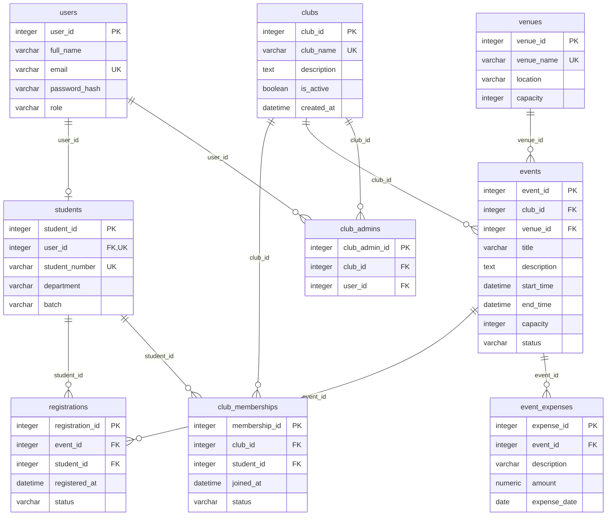

# Entity relationship diagram

PK = primary key; FK = required foreign key; UK = single-column unique key. Parents may have zero child rows.

Registration and ClubMembership are associative entities, not direct many-to-many shortcuts. Composite unique pairs are `(event_id, student_id)`, `(club_id, student_id)`, and `(club_id, user_id)` for ClubAdmin. They apply across all statuses, including cancelled rows. Student.user_id is unique, giving User an optional one-to-one Student profile.

All fields and constraint details are in [schema.md](schema.md). Service-level capacity and authorization rules are explained in [database-design.md](database-design.md) and [viva-preparation.md](viva-preparation.md).
